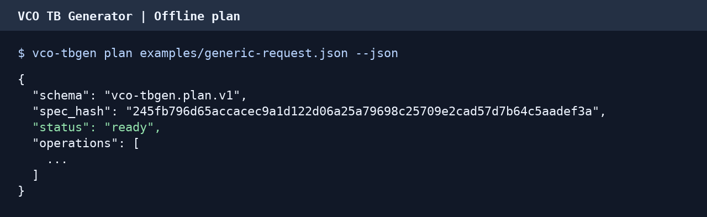

# VCO TB Generator

[简体中文](README.zh-CN.md)

Generate a Virtuoso testbench and Maestro analysis setup for an LC VCO.



## What it does

- Browse OA libraries and inspect DUT terminals before assigning their roles.
- Build a fixture with supplies, voltage or current controls, and a decimal-to-binary Verilog-A register for multi-bit controls.
- Create a schematic and config, then add HB and HBNOISE with frequency, phase-noise and supply-power outputs.
- Add a test to an existing Maestro setup or build an ISF test with HB, HBNOISE, HBXF and selected probes.
- Run the saved test and qualify required outputs, saves and corner/sweep coverage.

## Requirements

The Python 3.11+ CLI and API can validate and plan a request offline. Native operations require your own licensed Virtuoso IC6.1.8-class and Spectre installation, matching PDK, and OA library mapping. The package has no GUI or third-party Python runtime dependencies.

Existing IC6.1.8 setups can inherit saved global model-group corners. The
generator qualifies reported model files and sections alongside the sweep
variables. See [calling rules](docs/CALLING_RULES.md).

## Install and run the offline example

From the repository root, in a Python 3.11+ environment:

```sh
python -m pip install .
vco-tbgen plan examples/generic-request.json --json
```

The plan returns `status: ready` for a fictional L-c fixture. Planning reads the request and validates the spec. It works without a Cadence installation, OA libraries or model files. See [the example](examples/README.md) for its inputs.

## Using with Cadence

Provide the DUT's OA identity, a `cds.lib` mapping, an owned workspace, and your [PDK binding file](docs/BINDINGS.md). Set `TBGEN_VIRTUOSO` for a Virtuoso executable outside `PATH`, and set `TBGEN_ENVIRONMENT_SCRIPT` if your site uses a shell setup script. Requests can override those defaults under `runtime`.

Use an exported Design Lab project, a saved Maestro test or a new fixture around a selected DUT cell. The [API guide](docs/API.md) describes all three entry modes and an optional command wrapper for site locks or scheduling.

## CLI

| Command | Input and result |
| --- | --- |
| `browse --cds-lib PATH` | Native library and cell inventory |
| `describe --cds-lib PATH --lib LIB --cell CELL` | Native symbol terminals |
| `classify DESCRIPTOR.json` | Offline port role and bus suggestions |
| `dut-only REQUEST.json` | L-a native DUT readback |
| `from-design-lab REQUEST.json --level L-b` | Fixture spec from an export or project. Use `L-c` for oscillator analyses. |
| `plan SPEC.json` | Offline validation, operations and spec hash |
| `materialize SPEC.json --plan PLAN.json` | Native schematic/config or Maestro setup |
| `run MATERIALIZED.json` | Run the named saved Maestro test |
| `results RECEIPT.json` | Retrieve recorded results or poll a run handle |

## Calling rules

- [Calling rules for host applications](docs/CALLING_RULES.md): discovery, levels, lifecycle, writing rules and how VCO ISF Explorer calls the generator.

## Limitations

Historical native verification covered one Virtuoso IC6.1.8 and Spectre 18.1 installation and three CMOS processes. Process names are withheld. The example uses fictional bindings and synthetic input values. Existing-test preservation is qualified for setupdb v6 and statedb v5. The generator prepares and checks the testbench and results. Oscillator design, broader tool qualification, and circuit sign-off are the user's responsibility.

See the [specification](docs/SPEC.md) for levels L-a through L-d, session preservation and result qualification.

## Not included in this repository

The following are not part of this repository:

- Bindings for real PDKs. `examples/generic-binding.json` is fictional; write your own as described in [docs/BINDINGS.md](docs/BINDINGS.md).
- Your Cadence Virtuoso, Maestro and Spectre installation, OA libraries, models and licences, needed for every native step.
- Oscillator design and sign-off. The generator builds and checks testbenches; it does not size or verify the circuit.
- Qualification data from real processes. The example request and snapshots are synthetic.

If you need one of these, or an example for your setup, please open a [GitHub issue](https://github.com/chloeyntu-byte/vco-testbench-generator/issues); the maintainer will reply there.

## RF-FIELDWORK

- Lab home (all tools, narrated films and progress): https://rf-fieldwork.pages.dev/?lang=en
- This tool's page: https://rf-fieldwork.pages.dev/tbgen/?lang=en

Other open-source tools:

- [Flux Studio](https://github.com/chloeyntu-byte/flux-studio): parametric RF passives, EMX sweeps, multi-objective search and SNPFit
- [Tank Scan Lab](https://github.com/chloeyntu-byte/tank-scan-lab): LC tank scans (f0, Rp, gm, startup margin, loss shares), capacitor-array C/Q and resonance
- [Layout 3D Viewer](https://github.com/chloeyntu-byte/layout-3d-viewer): read IC layouts in 3D, locate pins and trace connections
- [VCO ISF Explorer](https://github.com/chloeyntu-byte/vco-isf-explorer): ISF, flicker-noise up-conversion and phase-noise contributions
- [VCO Design Studio](https://github.com/chloeyntu-byte/vco-design-studio): five literature LC VCO topology families, packaged schematics and native export

## License

[MIT](LICENSE)
