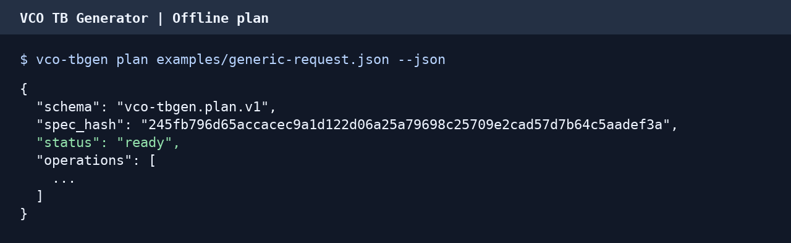

# VCO TB Generator

[English](README.md)

为 LC VCO 生成 Virtuoso 测试电路和 Maestro 分析设置。



## 功能

- 浏览 OA 库并读取 DUT 端口，供用户确认端口角色。
- 搭建含电源、电压或电流控制源的测试电路，用 Verilog-A 寄存器将多位控制的十进制输入转换为二进制电平。
- 生成 schematic 和 config，配置 HB、HBNOISE，并添加频率、相噪和电源功耗输出。
- 在已有 Maestro 设置中添加测试，或为 ISF 测试加入 HB、HBNOISE、HBXF 和选定探针。
- 运行已保存的测试，核验必需输出、保存信号，以及 corner 和 sweep 的覆盖情况。

## 环境要求

Python 3.11+ 可离线验证输入和生成计划。原生操作需要自行准备有许可证的 Virtuoso IC6.1.8 级环境、Spectre、相应 PDK 和 OA 库映射。软件提供 CLI 和 Python 接口，无图形界面和第三方 Python 运行依赖。

现有 IC6.1.8 配置可继承保存的全局模型组工艺角。结果校验会核对模型文件、
section 和扫参变量。参见 [调用规则](docs/CALLING_RULES.md)。

## 安装与离线示例

在仓库根目录，使用 Python 3.11 或更新版本：

```sh
python -m pip install .
vco-tbgen plan examples/generic-request.json --json
```

示例是虚构的 L-c 请求，计划返回 `status: ready`。规划阶段仅读取并验证请求，无需 Cadence、OA 库或模型文件。输入说明见[离线示例](examples/README.md)。

## 在 Cadence 中使用

提供 DUT 的 OA 标识、`cds.lib` 映射、可写工作区及自己的 [PDK 绑定文件](docs/BINDINGS.md)。如果可执行文件不在 `PATH`，可设置 `TBGEN_VIRTUOSO`。如需加载本地环境脚本，可设置 `TBGEN_ENVIRONMENT_SCRIPT`。请求也可通过 `runtime` 指定这两项。

支持已导出的 Design Lab 工程、已有 Maestro 测试，以及为选定 DUT 新建测试电路。[API 指南](docs/API.md)描述了三种入口和供本地加锁或调度使用的可选命令模板。

## CLI

| 命令 | 输入与输出 |
| --- | --- |
| `browse --cds-lib PATH` | 读取库及 cell 列表 |
| `describe --cds-lib PATH --lib LIB --cell CELL` | 读取 symbol 端口 |
| `classify DESCRIPTOR.json` | 离线建议端口角色及总线顺序 |
| `dut-only REQUEST.json` | 原生读取 L-a DUT |
| `from-design-lab REQUEST.json --level L-b` | 根据导出数据或工程生成 spec。用 `L-c` 配置振荡器分析。 |
| `plan SPEC.json` | 离线校验并返回计划与 spec 哈希 |
| `materialize SPEC.json --plan PLAN.json` | 原生生成 schematic/config 或 Maestro 测试 |
| `run MATERIALIZED.json` | 运行指定的已保存 Maestro 测试 |
| `results RECEIPT.json` | 读取结果或查询后台运行状态 |

## 调用规则

- [宿主程序调用规则](docs/CALLING_RULES.md)（英文）：如何找到生成器、完整度等级、调用流程、写入规则，以及 VCO ISF Explorer 的调用方式。

## 限制

原生流程此前在一套 Virtuoso IC6.1.8 与 Spectre 18.1 环境中覆盖三种 CMOS 工艺验证，工艺名不公开。示例采用虚构绑定和合成输入。已有测试保留机制仅验证了 setupdb v6 和 statedb v5。生成器负责准备和核验测试电路及结果。振荡器设计、其它版本的兼容性验证和签核由用户负责。

L-a 至 L-d、会话保留和结果核验详见[规范](docs/SPEC.md)。

## 未随仓库提供的内容

以下内容不随本仓库提供：

- 真实 PDK 的绑定文件。`examples/generic-binding.json` 是虚构的，请按 [docs/BINDINGS.md](docs/BINDINGS.md) 自己编写。
- 你自己的 Cadence Virtuoso、Maestro、Spectre 安装，以及 OA 库、模型和许可证；所有原生步骤都需要。
- 振荡器设计与签核。生成器只负责建立和检查测试台，不做尺寸设计，也不验证电路。
- 真实工艺的验证数据。示例请求和快照都是合成的。

需要其中某一项，或想为你的环境要一个示例，请在 [GitHub Issues](https://github.com/chloeyntu-byte/vco-testbench-generator/issues) 提出，维护者会在那里回复。

## RF-FIELDWORK

- 总站（全部工具、演示片与项目进展）：https://rf-fieldwork.pages.dev/?lang=zh
- 本工具介绍页：https://rf-fieldwork.pages.dev/tbgen/?lang=zh

其他开源工具：

- [Flux Studio](https://github.com/chloeyntu-byte/flux-studio)：参数化射频无源器件、EMX 扫参、多目标优化与 SNPFit 拟合
- [Tank Scan Lab](https://github.com/chloeyntu-byte/tank-scan-lab)：LC 谐振腔扫描（f0、Rp、gm、起振裕量、损耗分摊）、电容阵列 C/Q 与谐振
- [Layout 3D Viewer](https://github.com/chloeyntu-byte/layout-3d-viewer)：三维阅读版图、定位 pin、追踪连接
- [VCO ISF Explorer](https://github.com/chloeyntu-byte/vco-isf-explorer)：ISF、闪烁噪声上变频与相噪贡献
- [VCO Design Studio](https://github.com/chloeyntu-byte/vco-design-studio)：五类文献 LC VCO 拓扑、分层原理图与原生导出

## 许可证

[MIT](LICENSE)
